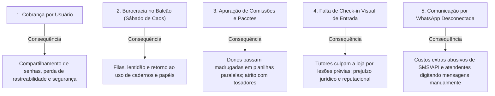

# Pesquisa de Mercado & Benchmarking de Concorrentes: ERP para Pet Shops e Clínicas Veterinárias

> **Documento Estratégico de Produto (Discovery & Validação)**  
> **Data:** Novembro de 2026  
> **Objetivo:** Mapear os gargalos operacionais e dores críticas dos usuários dos principais softwares de gestão veterinária e pet shop no Brasil para fundamentar o desenvolvimento de um ERP simplificado e de alto valor.

---

## 1. Contexto do Mercado Pet no Brasil
O Brasil possui a segunda maior população de cães e gatos do mundo e um mercado pet que movimenta dezenas de bilhões de reais anualmente. No entanto, o ecossistema é predominantemente fragmentado e formado por **PMEs (Pequenas e Médias Empresas)**:
- Pet shops de bairro com serviços de banho e tosa e venda de ração/acessórios.
- Clínicas veterinárias de 1 a 3 consultórios com foco ambulatorial, vacinas e pequenos procedimentos.
- Profissionais autônomos e veterinários volantes (atendimento domiciliar).

---

## 2. Análise Detalhada dos Principais Concorrentes

### 2.1 SimplesVet
* **Posicionamento:** Líder absoluto de mercado e referência nacional em presença de marca. Cobre prontuário clínico, agenda de estética, PDV, estoque e emissão fiscal.
* **Modelo de Negócio:** Assinatura SaaS com cobrança escalonada **por pacote de usuários**:
  - *Clínica e Hospital:* R$ 359/mês (até 3 usuários), R$ 419/mês (até 5), R$ 479/mês (até 10), R$ 589/mês (até 15) até R$ 1.099/mês (ilimitado).
  - *Pet Shop Básico:* R$ 149/mês (até 3 usuários).
  - *Pet Shop Avançado:* R$ 220/mês (até 5 usuários).
* **Pontos Críticos Relatados pelos Clientes:**
  - **Penalização do crescimento (Cobrança por assento):** Por cobrar por usuário, os lojistas compartilham logins e senhas entre recepcionistas, banhistas e veterinários, quebrando a auditoria de caixa e segurança.
  - **Sobrecarga de interface ("Tabs Hell"):** O sistema tornou-se pesado. Para realizar ações cotidianas (cadastrar tutor, agendar banho e lançar no caixa), o usuário precisa abrir 3 a 5 abas e passar por múltiplos cliques.
  - **Lentidão em picos operacionais:** Aos sábados pela manhã (momento de maior movimento de banho e tosa), a lentidão na nuvem ou falha de requisição gera filas e desgaste com os clientes.
  - **Treinamento custoso:** Devido à alta rotatividade (*turnover*) de atendentes de balcão, cada nova contratação demanda semanas de treinamento para aprender a navegar nas centenas de botões.

### 2.2 Vetus (Grupo Petlove)
* **Posicionamento:** ERP corporativo voltado para clínicas médicas de médio/grande porte, hospitais veterinários 24h e redes de franquias.
* **Pontos Críticos Relatados pelos Clientes:**
  - **Engessado e complexo:** Concebido com arquitetura densa. O prontuário médico exige dezenas de campos para uma simples consulta de rotina ou aplicação de vacina.
  - **Suporte burocrático e robotizado:** Atendimento exclusivamente digital por tickets/chat sem telefone ativo, gerando filas de espera em momentos de urgência clínica.
  - **Overkill para o pequeno lojista:** Inadequado e caro para pet shops que têm foco principal em banho/tosa e balcão rápido.

### 2.3 Nuvem Vet
* **Posicionamento:** Solução mais acessível, moderna e enxuta, focada em veterinários autônomos e pequenos consultórios.
* **Pontos Críticos Relatados pelos Clientes:**
  - **Carência em banho e tosa e pacotes:** Excelente para ficha clínica simples, mas fraco na esteira operacional de estética animal (agendamentos por porte, controle de pacotes e comissões de tosadores).
  - **Relatórios gerenciais limitados:** Dificuldade em cruzar saídas operacionais de insumos com fluxo de caixa e curva ABC de produtos.

### 2.4 Sispet (EA7 Sistemas)
* **Posicionamento:** Destaque na gestão de estética animal, hotelzinho pet e creche (*daycare*), além da funcionalidade "Super Agenda".
* **Pontos Críticos Relatados pelos Clientes:**
  - **Interface tradicional:** Telas com densidade visual ultrapassada e fluxo de fechamento de caixa pouco intuitivo.
  - **Integração fragmentada:** Dificuldade em conciliar pacotes promocionais com o fechamento automático de comissões da equipe.

---

## 3. Os 5 Grandes Gargalos do Mercado (Complaint-Driven Discovery)

### Gargalo 1: O "Taxímetro" de Usuários
* O dono de pet shop contrata estagiários, recepcionistas de final de semana e tosadores comissionados. Cobrar por funcionário incentiva o lojista a manter todo mundo na mesma conta de "Administrador".
* **Oportunidade:** Modelo com **usuários ilimitados**, cobrando pelo porte do negócio ou plano fixo transparente.

### Gargalo 2: O Caos do Sábado de Manhã e Excesso de Cliques
* O balcão do pet shop no sábado é ruidoso, rápido e exige agilidade. Telas que pedem 15 campos obrigatórios (CPF, CEP, cor exata do olho do pet) antes de vender um produto geram abandono e anotação em papel.
* **Oportunidade:** **Fast-POS (Caixa Rápido em 1 Tela)**. Cadastro progressivo (começa apenas com Nome e WhatsApp do tutor).

### Gargalo 3: O Fechamento de Comissões de Pacotes Promocionais
* Pacotes como *"Compre 4 banhos, ganhe 1 hidratação"* são o padrão comercial do setor. Os sistemas legados calculam mal o desconto comercial versus a mão de obra do tosador.
* **Oportunidade:** Painel e extrato transparente de comissões, onde o profissional de estética acompanha em tempo real seus ganhos do dia sem surpresas no fim do mês.

### Gargalo 4: A Falta de Check-in Visual ("Ele não veio assim")
* Animais chegam com dermatites, pulgas, nós graves ou pequenos arranhões. Ao retirar o pet tosado, o tutor acusa o estabelecimento de negligência.
* **Oportunidade:** Check-in rápido no celular/tablet com 2 fotos e checklist (nó, pulga, machucado prévio) gerando termo de responsabilidade enviado via WhatsApp.

### Gargalo 5: WhatsApp como Canal Central e Gratuito
* O tutor não abre e-mail nem atende telefone durante o expediente. Ele quer saber se o cachorro está pronto via WhatsApp.
* **Oportunidade:** Disparos de status operacionais (*Aguardando > No Banho > Secando > Pronto para Retirada*) com 1 clique, integrados diretamente ao fluxo da ordem de serviço.

---

## 4. Matriz de Valor do ERP Simplificado ("O Anti-SimplesVet")

| Dimensão | Softwares Tradicionais (SimplesVet, Vetus) | O ERP Simplificado Proposto |
| :--- | :--- | :--- |
| **Arquitetura de Telas** | Dezenas de abas, menus aninhados e modais bloqueantes | Navegação limpa, responsiva, fluxo guiado por etapas |
| **Precificação** | Cobrança por assento / usuário adicional | Usuários ilimitados; foco em simplicidade operacional |
| **Operação de Balcão** | Processo fragmentado entre Agenda, PDV e Estoque | Checkout integrado: cobra atendimento + produtos em 1 tela |
| **Comissões** | Cálculo rígido com fechamento demorado | Lançamento automático por serviço com extrato do profissional |
| **Aderência Acadêmica (UFAPE)** | N/A | Totalmente aderente aos 6 módulos integrados exigidos para a 1ª e 2ª VA |
