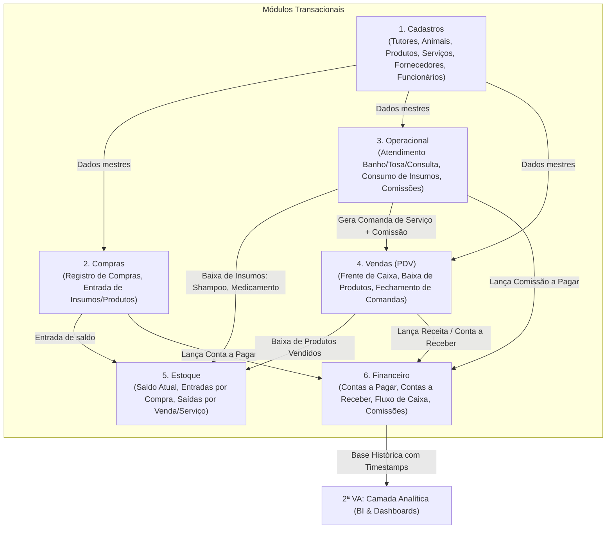

# Especificação do Projeto Prático: Sistemas de Informação e Tecnologias (UFAPE 2026.2)

> **Instituição:** Universidade Federal do Agreste de Pernambuco (UFAPE)  
> **Curso:** Bacharelado em Ciência da Computação  
> **Disciplina:** Sistemas de Informação e Tecnologias (2026.2)  
> **Professor:** Dr. Assuero Fonseca Ximenes  
> **Domínio de Negócio Escolhido:** ERP Simplificado para Pet Shops e Clínicas Veterinárias ("PetFlow ERP")

---

## 1. Objetivo do Projeto Acadêmico

Desenvolver de forma prática e integrada as partes essenciais de um **Sistema de Gestão (ERP)** simulando em escala reduzida as operações de uma organização real:
- **1ª VA:** Camada operacional e transacional (ERP simplificado) com geração consistente de dados históricos e integridade relacional.
- **2ª VA:** Camada analítica (Business Intelligence / Dashboard) utilizando os dados gerados na 1ª VA para apoio à tomada de decisão gerencial.

---

## 2. Infraestrutura Tecnológica Obrigatória

De acordo com o item 4.1 da especificação da disciplina, a base tecnológica deve seguir estritamente:

1. **Linguagem & Interface:** **Python** com **Streamlit**.
2. **Sistema Gerenciador de Banco de Dados:** **PostgreSQL** relacional.
3. **Hospedagem do Banco de Dados:** **Supabase** (banco em nuvem com alta disponibilidade e acesso remoto).
4. **Autenticação:** **Google Auth** (login institucional/Google para controle de acesso e auditoria).
5. **Hospedagem da Aplicação:** **Streamlit Community Cloud** (URL pública acessível pela Internet).
6. **Versionamento:** Repositório público no **GitHub**.

---

## 3. Os 6 Módulos Obrigatórios e Suas Integrações

O projeto atende com rigor aos 6 módulos operacionais obrigatórios:

### Detalhamento dos Módulos no Contexto Pet:

#### Módulo 1: Cadastros (Dados Mestres)
- **Tutores & Animais:** Cadastro ágil do cliente com seus respectivos animais (porte, raça, restrições e alergias).
- **Colaboradores:** Identificação de tosadores, banhistas, veterinários e recepcionistas (com % de comissão cadastrada).
- **Produtos:** Itens de revenda (rações, remédios, brinquedos) e insumos de uso interno (shampoos, vacinas).
- **Serviços:** Tabela de preços de serviços (Banho Simples, Tosa na Tesoura, Consulta Clínica, Aplicação de Vacina).
- **Fornecedores:** Distribuidores de cosméticos pet, rações e laboratórios veterinários.

#### Módulo 2: Compras
- Registro de pedidos de compra de insumos e produtos para revenda com data, fornecedor, quantidade e custo unitário.
- **Gatilho de Integração:** Atualiza automaticamente o saldo no **Estoque** e gera títulos no **Contas a Pagar** do Financeiro.

#### Módulo 3: Operacional (O Coração do Negócio)
- Ordem de Serviço / Atendimento de Estética e Clínica:
  - Registro do animal e tutor atendidos.
  - Seleção do profissional responsável (gera cálculo de comissão com base na regra cadastrada).
  - Registro de insumos utilizados no procedimento (ex: 1 dose da vacina X, 100ml do shampoo hipoalergênico).
- **Gatilho de Integração:** Dá baixa dos insumos no **Estoque**, envia a comanda para finalização no módulo de **Vendas (PDV)** e registra a provisão da comissão no **Financeiro**.

#### Módulo 4: Vendas (Frente de Caixa / PDV)
- Caixa rápido em tela única: recebe a comanda de serviços do animal finalizados no módulo operacional e permite adicionar produtos de balcão (ex: sachê, petisco).
- Registro de forma de pagamento (Pix, Cartão de Crédito/Débito, Dinheiro) e data/hora (`created_at`).
- **Gatilho de Integração:** Dá baixa imediata dos produtos de revenda no **Estoque** e lança a receita no **Contas a Receber / Caixa** do Financeiro.

#### Módulo 5: Estoque
- Controle unificado de inventário:
  - Saldo em tempo real por produto/insumo.
  - Alerta de estoque mínimo (ex: alertar quando o galão de shampoo estiver com menos de 2 unidades).
  - Extrato detalhado de movimentação: rastreia se a saída ocorreu por venda de balcão ou por consumo no banho/tosa/consulta.

#### Módulo 6: Financeiro
- Consolidação dos impactos monetários de toda a empresa:
  - **Entradas:** Receitas de vendas de balcão e serviços de banho/consulta.
  - **Saídas:** Pagamentos de compras de fornecedores e pagamento de comissões aos tosadores/vets.
  - **Fluxo de Caixa Operacional:** Saldo diário, visão de contas a pagar vs. a receber e lucratividade líquida.

---

## 4. Planejamento Estratégico para a 2ª VA (Business Intelligence)

Para garantir nota máxima na 2ª VA sem retrabalho, o banco de dados da 1ª VA registrará com precisão:
- **Temporalidade (Timestamps):** Data e hora exatas de cada agendamento, atendimento, venda e despesa.
- **Rastreabilidade por Entidade:** Qual profissional gerou mais receita, qual raça/porte consome mais serviços, qual horário tem maior pico.
- **KPIs previstos para a 2ª VA:**
  1. *Faturamento Total e Margem Operacional líquida.*
  2. *Ticket Médio por Tutor e por Atendimento.*
  3. *Curva ABC de Produtos e Serviços mais rentáveis.*
  4. *Taxa de Ocupação e Produtividade dos Tosadores/Veterinários.*
  5. *Índice de Retorno de Clientes (LTV e Frequência de Banhos).*

---

## 5. Cronograma & Entregáveis Oficiais

- **8 de Dezembro:** Entrega do link da aplicação em execução no Streamlit Community Cloud (integrada ao PostgreSQL no Supabase com login Google).
- **15 de Dezembro:** Entrega da documentação técnica completa da 1ª VA (MER, descrição de módulos, regras de negócio e fluxos de integração).
- **2ª VA:** Apresentação do Módulo de Dashboard (BI) e documento de análise de apoio à decisão.
